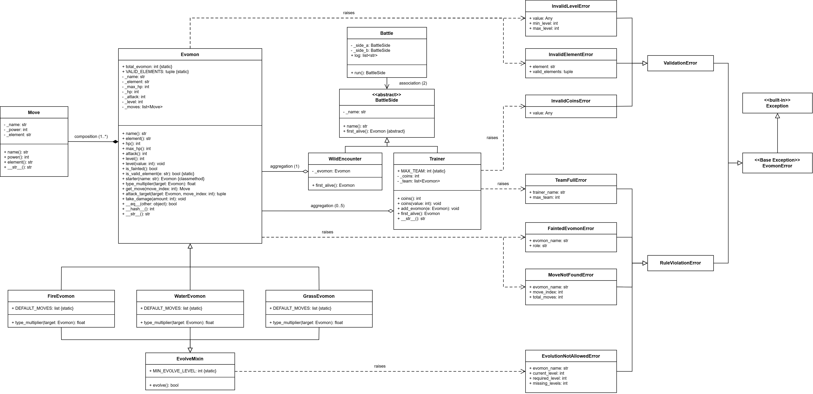

# Tugas Pertemuan 9: Exception Handling pada Proyek UTS — Game RPG Turn-Based "Evomon"

## 1. Identitas Kelompok
* **Mata Kuliah:** Pemrograman Berorientasi Objek (IF23U1411-PAGI2-20261)
* **Studi Kasus UTS:** Game RPG Turn-Based "Evomon" (Roblox)
* **Anggota Kelompok:**
  1. **I Ketut Agus Budi Suryananta** (`2501020051`)
  2. **[Evan Filbert]** (`[2501020042]`)
  3. **[Made Putra Sena Nugraha]** (`[2501020054]`)

---

## 2. Deskripsi Sistem
Sistem ini meniru mekanisme game RPG *turn-based* **Evomon** di Roblox. Pemain (**Trainer**) menangkap dan melatih makhluk bernama **Evomon**, lalu membawanya bertarung melawan Trainer lain maupun Evomon liar (**WildEncounter**). Setiap Evomon memiliki elemen (`Fire`, `Water`, `Grass`), level (1–100), HP, *attack*, serta jurus (**Move**).

Pada pengembangan **Tugas Pertemuan 9 (Exception Handling)** ini, seluruh validasi data dan aturan permainan ditegakkan menggunakan *custom exception* berbasis hierarki `EvomonError` (terbagi menjadi `ValidationError` dan `RuleViolationError`). Class domain tidak lagi mencetak pesan error secara langsung ke konsol, melainkan melemparkan *exception* menggunakan `raise` yang ditangani oleh program utama (`src/main.py`) dengan `try / except / else / finally`, urutan `except` spesifik ke umum, *re-raise*, *exception chaining* (`raise ... from e`), dan gaya **EAFP**.

---

## 3. Tabel Aturan Bisnis

| No | Aturan Bisnis | Class & Method Penegak | Exception yang Dimunculkan |
| :-: | :--- | :--- | :--- |
| 1 | Level Evomon harus bilangan bulat (`int`) di rentang **1–100**. | `Evomon.level` (`@level.setter`) | `InvalidLevelError` |
| 2 | Coins Trainer harus bilangan bulat (`int`) dan **tidak boleh negatif** (`>= 0`). | `Trainer.coins` (`@coins.setter`) | `InvalidCoinsError` |
| 3 | Elemen Evomon harus salah satu dari `"Fire"`, `"Water"`, atau `"Grass"`. | `Evomon.__init__()` | `InvalidElementError` |
| 4 | Tim Trainer menampung **maksimal 5 Evomon** (`MAX_TEAM = 5`). | `Trainer.add_evomon(e)` | `TeamFullError` |
| 5 | Evomon yang sudah pingsan (`HP == 0`) **tidak boleh menyerang atau diserang**. | `Evomon.attack_target()` | `FaintedEvomonError` |
| 6 | Evomon **hanya bisa berevolusi jika mencapai minimal Level 16**. | `EvolveMixin.evolve()` | `EvolutionNotAllowedError` |
| 7 | Indeks jurus yang dipilih saat menyerang harus tersedia pada daftar `_moves` Evomon. | `Evomon.get_move(move_index)` | `MoveNotFoundError` (`from IndexError`) |

---

## 4. Class Diagram Revisi



---

## 5. Daftar Custom Exception

Seluruh custom exception berada pada `src/exceptions.py` dan mewarisi `EvomonError(Exception)`:

| Nama Exception | Class Induk | Atribut Konteks | Kapan Dimunculkan | Method Pemuncul | Penanganan di `main.py` |
| :--- | :--- | :--- | :--- | :--- | :--- |
| `EvomonError` | `Exception` | - | *Base exception* aplikasi Evomon | - | Penangkap umum terakhir (`except EvomonError`) |
| `ValidationError` | `EvomonError` | - | Kelompok kesalahan validasi data | - | Ditangkap di bawah exception validasi spesifik |
| `InvalidLevelError` | `ValidationError` | `value`, `min_level`, `max_level` | Level `< 1`, `> 100`, atau bukan `int` | `Evomon.level` setter | Menampilkan pesan dan rentang sah (`err.min_level`–`err.max_level`) |
| `InvalidCoinsError` | `ValidationError` | `value` | Coins `< 0` atau bukan `int` | `Trainer.coins` setter | Menampilkan nilai ditolak (`err.value`) dengan blok `else` & `finally` |
| `InvalidElementError` | `ValidationError` | `element`, `valid_elements` | Elemen di luar Fire/Water/Grass | `Evomon.__init__()` | Menampilkan elemen tidak valid beserta daftar elemen sah |
| `RuleViolationError` | `EvomonError` | - | Kelompok pelanggaran aturan main | - | Ditangkap di bawah exception aturan spesifik |
| `TeamFullError` | `RuleViolationError` | `trainer_name`, `max_team` | Menambah Evomon saat tim penuh (5) | `Trainer.add_evomon()` | Menampilkan kapasitas maksimal tim milik `err.trainer_name` |
| `FaintedEvomonError` | `RuleViolationError` | `evomon_name`, `role` | Evomon pingsan menyerang / diserang | `Evomon.attack_target()` | Menampilkan pesan dan aksi yang ditolak (`err.role`) |
| `EvolutionNotAllowedError` | `RuleViolationError` | `evomon_name`, `current_level`, `required_level`, `missing_levels` | Evolusi saat level `< 16` | `EvolveMixin.evolve()` | Dicatat via *re-raise* lalu menampilkan `err.missing_levels` |
| `MoveNotFoundError` | `RuleViolationError` | `evomon_name`, `move_index`, `total_moves` | Akses indeks jurus di luar list (EAFP) | `Evomon.get_move()` | Menampilkan pesan dan penyebab asli (`err.__cause__` = `IndexError`) |

---

## 6. Cara Menjalankan dan Contoh Output

### Perintah Menjalankan
```bash
PYTHONPATH=src python3 src/main.py
```

### Contoh Output
```text
Trainer Ash (2 Evomon, 100 coins)
Trainer Gary (1 Evomon, 100 coins)
Flamy [Fire] Lv5 HP 45/45
Total Evomon: 3
Error Level: Level harus bilangan bulat 1-100, diberikan: 150 (rentang sah: 1-100)
Coins Ash berhasil diubah menjadi 150
[finally] Validasi coins untuk nilai 150 selesai
Error Coins: Coins harus bilangan bulat >= 0 (tidak boleh negatif), diberikan: -50 (nilai ditolak: -50)
[finally] Validasi coins untuk nilai -50 selesai
Error Elemen: Elemen 'Electric' tidak valid. Pilihan elemen sah: Fire, Water, Grass
Error Tim: Tim Trainer Penuh sudah penuh (maksimal 5 Evomon) (kapasitas Penuh: 5)
flamy == clone  : True
flamy == aquaro : False
MRO: [FireEvomon, Evomon, EvolveMixin, object]
--- Turn 1 ---
Flamy memakai Flame Burst -> Aquaro -16 HP (sisa 29)
Aquaro memakai Aqua Jet -> Flamy -48 HP (sisa 0)
--- Turn 2 ---
Leafy memakai Leaf Storm -> Aquaro -48 HP (sisa 0)
Pemenang: Ash
Battle selesai tanpa error
[finally] Sesi Battle Ash vs Gary ditutup
Flamy [Fire] Lv5 HP 0/45
Error Serang: Flamy sudah pingsan (HP 0) dan tidak bisa menyerang (aksi ditolak: menyerang)
[LOG AUDIT] Percobaan evolusi gagal pada Flamy (Lv5)
Error Evolusi: Flamy (Lv5) belum bisa evolusi (butuh Lv16, kurang 11 level) -> butuh 11 level lagi
Leafy berevolusi! ATK=22, HP=65/65
[finally] Pemeriksaan evolusi Leafy selesai
Error Serang: Aquaro sudah pingsan (HP 0) dan tidak bisa diserang
Error Jurus (EAFP): Leafy tidak memiliki jurus pada indeks ke-99 (tersedia 2 jurus) (penyebab asli: IndexError)
Setelah Ash dihapus: Leafy [Grass] Lv16 HP 65/65
=== Battle melawan Evomon liar ===
--- Turn 1 ---
Bushy memakai Leaf Storm -> Wildy -48 HP (sisa 0)
Pemenang: Brock
```

---

## 7. Pembagian Peran Anggota
1. **I Ketut Agus Budi Suryananta (`2501020051`)**: Mengembangkan program utama (`src/main.py`) dengan `try/except/else/finally`, *re-raise*, urutan `except`, serta menyusun dokumentasi `README.md`.
2. **[Evan Filbert] (`[2501020042]`)**: Merancang hierarki custom exception (`src/exceptions.py`) dengan atribut konteks dan merevisi *Class Diagram UML* (`docs/class-diagram.png`).
3. **[Made Putra Sena Nugraha] (`[2501020054]`)**: Mengetik commit awal kode UTS, lalu memperbarui class domain (`src/evomon.py`) dengan `raise`, EAFP, dan *exception chaining*.
